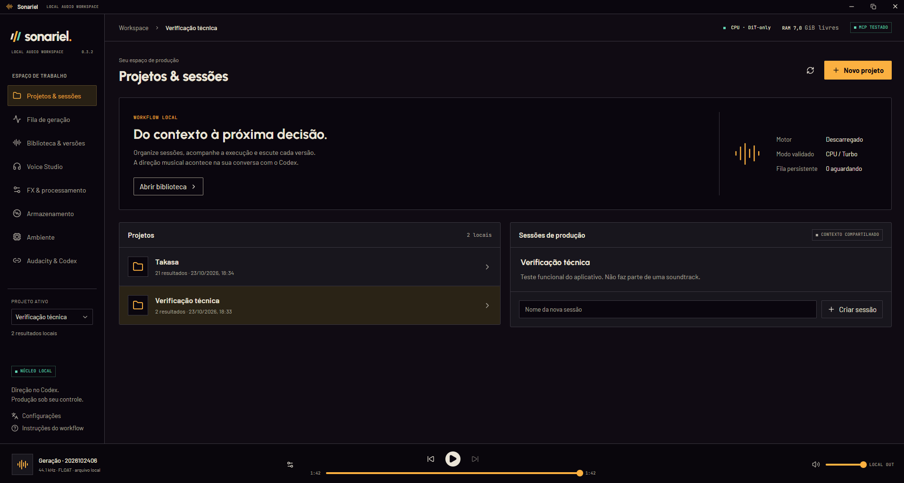
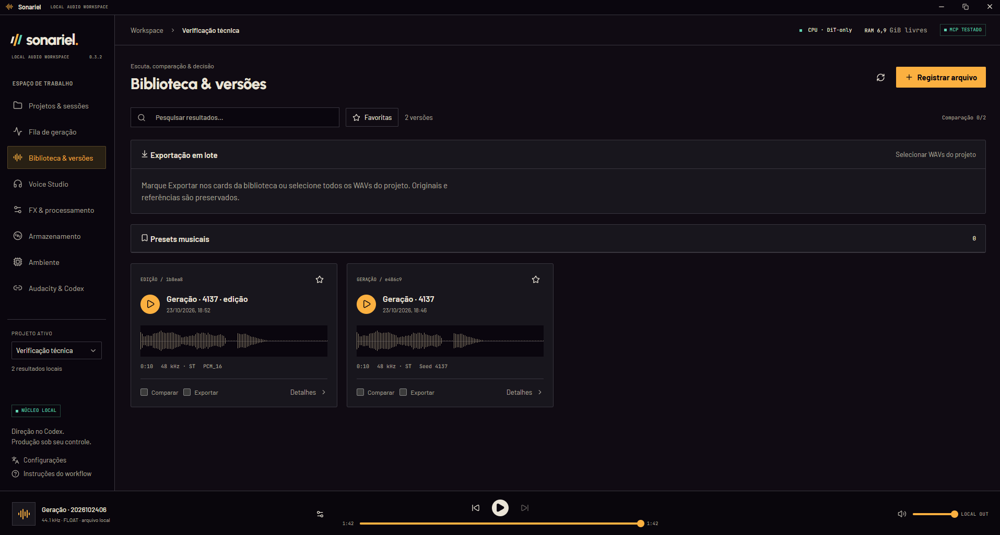
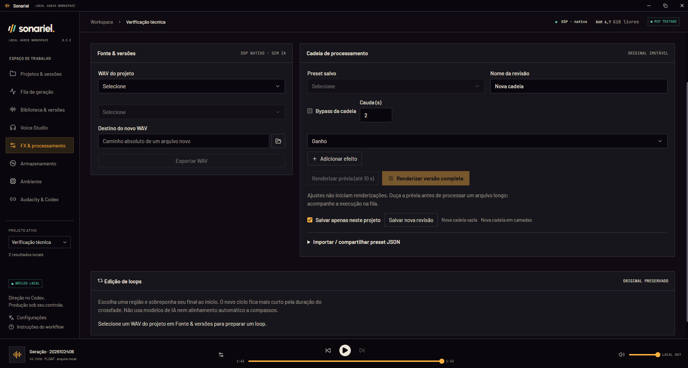
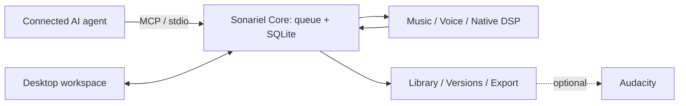

[English](README.md) | [Português (Brasil)](README.pt-BR.md)

# Sonariel

**Local audio production, directed by your connected AI agent.**

Sonariel is a source-available Windows desktop application that brings music generation, multilingual voice synthesis, native DSP, and project/version management into one workflow. Direct the work through an MCP-connected agent; use the desktop to follow execution, listen, compare, process, and organize the results.

[Download for Windows](https://github.com/SCamposs/sonariel/releases/latest) · [Quick start](docs/QUICK_START.md) · [Documentation](docs/README.md) · [Changelog](CHANGELOG.md)

*Real v0.3.2 desktop captures supplied by the author and also used in the portfolio, without the remote-control cursor overlay. The interface shown is in Brazilian Portuguese; v0.4.0 also supports English. These screenshots are interface views, not evidence of an AI generation run or a performance benchmark. [Capture details](docs/SHOWCASE.md).*

**Current release: [v0.6.1](https://github.com/SCamposs/sonariel/releases/tag/v0.6.1).** Completes the recommended Medium FP32 / SAME-L source-audio recipe with an optional FP32 encoder and transformation 0.65, retaining the clearer workflows and branded installer. Includes English/pt-BR UI and existing production tools. [Release review](docs/releases/v0.6.1-validation.md). Loop creation is disabled in packaged distributions; existing audio is preserved. Windows installation/basic use was validated. The complete v0.3.2 → v0.4.0 installer/updater lifecycle was not tested; this documented caveat was accepted by the maintainer. See the [Phase 2.7 acceptance report](docs/PHASE2_7.md).

## From a request to a usable version

- **Generate locally:** ACE-Step music, experimental Stable Audio variations, and multilingual Chatterbox V3 voice synthesis.
- **Process non-destructively:** ordered or layered native DSP, explicit short previews, reusable presets, and new WAV versions without overwriting the source.
- **Keep the context:** projects, sessions, parameters, seeds, source relationships, favorites, and production notes.
- **Listen and decide:** persistent playback, two-version comparison, waveforms, and result details.
- **See the work:** one persistent queue shared by desktop and MCP, real job stages, memory readings, and per-engine setup.
- **Control the files:** registered-audio inventory, protected references, recoverable discard, verified WAV exports, and optional Audacity handoff.

### Inside the workspace

Native FX workspace

These views show the real project, library and effects workspaces. The FX capture includes historical loop controls; loop creation is disabled in the packaged v0.4.0 release. See the [queue capture and screenshot provenance](docs/SHOWCASE.md) for context.

## Agent integration, not a second chat window

The connected agent handles creative direction and calls Sonariel's MCP tools. Sonariel manages execution and persistent production state; it is not an autonomous agent with its own language model.

Codex is the integration exercised in this project. The server uses MCP over local stdio and is designed for interoperability, but Claude Code, Cursor, Copilot, and other clients are **not claimed as tested integrations**. [MCP setup and contracts](docs/CODEX.md).

Audio-engine inference runs on your computer. The connected agent's model is separate and may use a remote service; local audio generation does not make Codex or another agent local. Consider what you share with that client separately from Sonariel's audio processing.

## Engines and requirements

The distributed profile is **Windows x64, CPU, one task at a time**. GPU inference is not supported by these adapters. Opening the desktop or MCP connection does not load the models.

| Engine | Implemented role | Available RAM required to start |
| --- | --- | --- |
| ACE-Step 1.5 Turbo | Baseline music generation and source-guided cover, DiT-only | 12 GiB cold / 4 GiB with the managed model resident |
| Stable Audio 3 Small-Music / Medium | Experimental LiteRT CPU music; text-to-audio and explicit source-audio variation | 5 / 6 GiB |
| Stable Audio 3 Medium optional FP32 / SAME-L | Text generation (7.60 GB extra) or explicit source-audio variation with SAME-L FP32 encoder (9.31 GB extra in total) | 12 GiB |
| Chatterbox Multilingual V3 | Experimental multilingual speech and optional authorized reference profiles | 7.5 GiB |
| Native DSP | WAV processing, chains, layers, previews, presets, and export | 3 GiB |

These are **queue admission thresholds, not guarantees of sufficient memory**. ACE-Step has exceeded 14 GiB process RAM in local runs; longer audio and other applications affect headroom. The ACE setup recipe also requires at least 23 GiB total system RAM. SFT is listed as pending, not an operational engine. See [engine capabilities, limits, and terms](docs/ENGINES.md) and the [validation record](docs/VALIDATION.md).

## Download and install

1. Open the [official releases](https://github.com/SCamposs/sonariel/releases/latest) and download `Sonariel_<version>_x64-setup.exe`. The current stable release is [v0.6.1](https://github.com/SCamposs/sonariel/releases/tag/v0.6.1).
2. Install the desktop app. End users do **not** need Node.js, Rust, or a development Python installation. WebView2 is required; the installer offers its bootstrap component when needed.
3. Prepare a compatible engine separately through the app. Model weights are not bundled. Downloads require internet, disk space, and your authorization; external model terms still apply.

The installer does **not** have a Windows Authenticode publisher signature, so Windows may show an unknown-publisher warning. Updater packages have a separate cryptographic signature; that does not remove Windows publisher warnings. Updates are optional and installation requires confirmation. [Installation and update details](docs/QUICK_START.md#installation-and-updates).

## Quick start

1. Open Sonariel and use the optional first-use guide. Reopen it through **Instruções do workflow** in the sidebar.
2. If your task needs an engine, follow its preparation step in **Ambiente**. Choose a compatible existing installation or review an isolated setup. The recommended Medium FP32 / SAME-L recipe is optional; [review its costs and supported mode](docs/MUSIC_RECOMMENDATIONS.md).
3. In **Audacity & Codex**, choose **Configurar conexão Codex**, then reload the Codex MCP connection. A compatible MCP client is required for agent-directed generation; a working protocol handshake is distinct from client configuration.
4. Create/select a project in **Projetos & sessões** and save its production context.
5. Ask the agent for one short generation with explicit model, seed, and duration. For ACE-Step, also provide BPM, key, and time signature. For example:

   > Use Sonariel to generate one 15-second instrumental in the selected project with ACE-Step Turbo, seed 4137, 72 BPM, D minor, 4/4, batch size 1. A quiet original synthesizer study, no vocals or drums. Follow the existing CPU/DiT-only profile; do not enable the LM or Flash Attention. Submit once and report the job ID.

6. Follow **Fila de geração**. Low-memory waiting is a real queue state; do not repeatedly resubmit the request. There is no active-inference cancellation in this profile.
7. Listen in **Biblioteca & versões**, compare versions, and request an explicit preview in **FX & processamento** before a full render. Export a WAV or optionally hand a version to Audacity.

No model is required to import a WAV and use native FX. The [full quick start](docs/QUICK_START.md) explains the UI labels, setup choices, memory limits, and optional Audacity configuration.

## One core, two clients

The desktop and MCP client share the same lightweight core and persistent state. Heavy engines run separately, dependencies are installed in isolated environments, and new renders preserve their source. Core RPC is loopback-only with local authentication. There is no arbitrary shell executor or unrestricted Audacity command tool. [Architecture and process boundaries](docs/ARCHITECTURE.md).

## Data, licensing, and limitations

Project data defaults to `%USERPROFILE%\.sonariel`; `SONARIEL_HOME` selects a separate profile. Models, audio, references, databases, and private presets stay outside this repository. Sonariel has no usage telemetry; optional update checks contact GitHub, and setup downloads use external official sources. The connected agent has its own data-handling policy.

Recoverable discard keeps moved files for **30 days** and does not immediately free disk space. Expired trash is deleted while the core is open and the queue is idle, with a grace period for older trash. Separate confirmed permanent deletion frees space; imported originals require explicit opt-in. Only registered files appear in the inventory. [Storage behavior](docs/STORAGE.md).

Sonariel's own code and documentation use the [Sonariel Source Available License 1.0](LICENSE), **not an OSI-approved open-source license**. You can use the app free of charge, study/modify it, and redistribute it for free under its terms. Selling Sonariel, modified versions, or paid access to operate it requires separate permission.

The app license imposes no royalty or noncommercial restriction on your output. Commercial use of an audio result still depends on model terms and rights in references/source material; exclusive rights, copyrightability, and freedom from third-party claims are not guaranteed. Official generator watermarks are not deliberately disabled. Review [third-party notices](THIRD_PARTY_NOTICES.md) and the [engine guide](docs/ENGINES.md).

## Documentation and contributing

- [Documentation index](docs/README.md): current guides, languages, and historical validation records.
- [Quick start](docs/QUICK_START.md): installation, agent connection, and a first workflow.
- [Engine guide](docs/ENGINES.md): capabilities, RAM thresholds, and model-license boundaries.
- [Contributing](CONTRIBUTING.md): Windows development setup, tests, and privacy safeguards.
- [Issues](https://github.com/SCamposs/sonariel/issues): report reproducible problems or propose improvements.

Contributions should preserve local execution, explicit operations, and non-destructive versioning. Development uses Tauri 2, React/TypeScript, Python 3.12, and native Rust/C++ DSP; those build tools are not end-user prerequisites. Read [CONTRIBUTING.md](CONTRIBUTING.md) before setting up a development profile.
