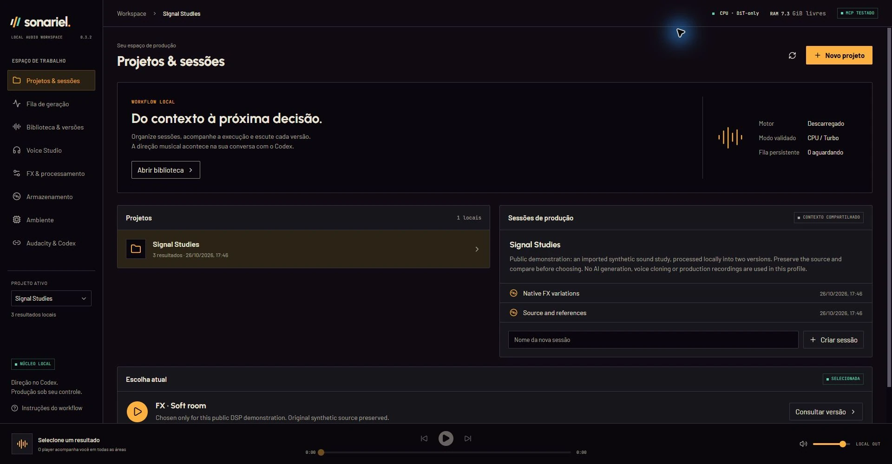
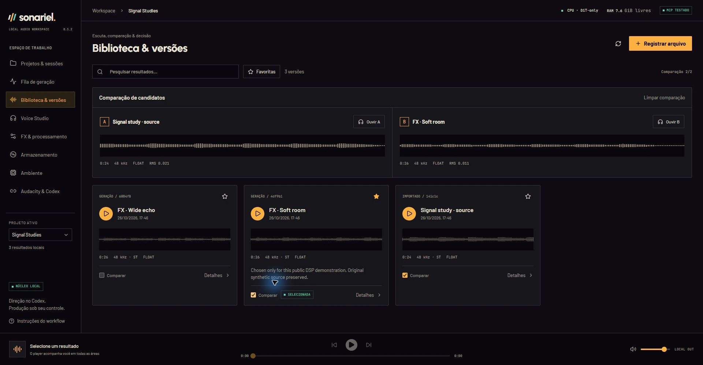
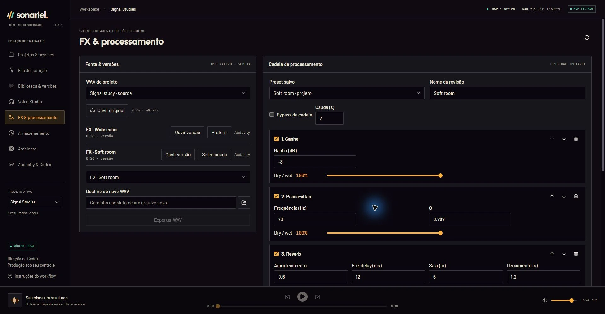
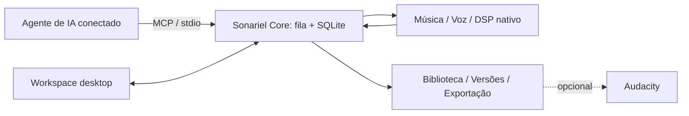

[English](README.md) | [Português (Brasil)](README.pt-BR.md)

# Sonariel

**Desenvolvimento na main:** interface em inglês/pt-BR, escolha de idioma antes do tutorial, loops não destrutivos, exportação WAV em lote e presets musicais versionados estão disponíveis ao compilar o código. Essas mudanças ainda não fazem parte do download v0.3.2. Use um perfil de prévia isolado: [validação e instruções da Fase 2](docs/PHASE2.md).

**Produção de áudio local, com direção pelo seu agente de IA conectado.**

O Sonariel é um aplicativo desktop source-available para Windows que reúne geração musical, síntese de voz multilíngue, DSP nativo e organização de projetos e versões. Dê a direção pelo agente conectado via MCP; use o app para acompanhar a execução, ouvir, comparar, processar e organizar os resultados.

[Baixar para Windows](https://github.com/SCamposs/sonariel/releases/latest) · [Primeiros passos](docs/QUICK_START.md) · [Documentação](docs/README.md) · [Changelog](CHANGELOG.md)

*Capturas reais do desktop v0.3.2. A interface permanece em português brasileiro. O perfil isolado usa um estudo sonoro sintético importado e renders reais do DSP nativo, não músicas geradas por IA ou material de produção. [Como as capturas foram feitas](docs/SHOWCASE.md).*

## Do pedido à versão utilizável

- **Geração local:** música com ACE-Step, variações experimentais com Stable Audio e vozes multilíngues com Chatterbox V3.
- **Processamento não destrutivo:** DSP nativo em cadeias ou camadas, prévias curtas explícitas, presets reutilizáveis e novos WAVs sem sobrescrever a fonte.
- **Contexto preservado:** projetos, sessões, parâmetros, seeds, relações de origem, favoritas e notas de produção.
- **Escuta e decisão:** player persistente, comparação de duas versões, formas de onda e detalhes dos resultados.
- **Execução visível:** uma fila persistente para desktop e MCP, etapas reais, leitura de memória e setup independente por motor.
- **Controle dos arquivos:** inventário dos áudios catalogados, referências protegidas, descarte recuperável, exportação WAV verificada e ponte opcional com Audacity.

### Dentro do aplicativo

Área de processamento nativo

Essas telas mostram um fluxo real de importação → DSP → comparação de versões. Não indicam que modelos de IA foram carregados para as capturas. Veja a [fila e a proposta de gravação](docs/SHOWCASE.md) para mais contexto.

## Integração com agentes, sem outro chat dentro do app

O agente conectado conduz a criação e chama as ferramentas MCP. O Sonariel administra a execução e o estado persistente da produção; não é um agente autônomo com um modelo de linguagem próprio.

Codex é a integração exercitada neste projeto. O servidor usa MCP por stdio local e foi projetado para interoperabilidade, mas Claude Code, Cursor, Copilot e outros clientes **não são anunciados como integrações testadas**. [Configuração e contratos MCP](docs/CODEX.md).

A inferência dos motores de áudio ocorre no seu computador. O modelo do agente é separado e pode usar um serviço remoto; geração local de áudio não torna Codex ou outro agente local. Avalie separadamente o que você compartilha com esse cliente.

## Motores e requisitos

O perfil distribuído é **Windows x64, CPU, uma tarefa por vez**. Os adaptadores não oferecem inferência por GPU. Abrir o desktop ou a conexão MCP não carrega modelos.

| Motor | Função implementada | RAM livre exigida para iniciar |
| --- | --- | --- |
| ACE-Step 1.5 Turbo | Padrão musical, geração e cover com áudio-fonte, DiT-only | 12 GiB a frio / 4 GiB com o modelo gerenciado residente |
| Stable Audio 3 Small-Music / Medium | Música experimental via LiteRT CPU; texto e variação com fonte explícita | 5 / 6 GiB |
| Chatterbox Multilingual V3 | Voz multilíngue experimental e perfis opcionais com referência autorizada | 7,5 GiB |
| DSP nativo | WAVs, cadeias, camadas, prévias, presets e exportação | 3 GiB |

São **limites para admitir a tarefa na fila, não garantias de memória suficiente**. O ACE-Step ultrapassou 14 GiB no processo em execuções locais; duração e outros aplicativos afetam a folga. A receita de instalação do ACE também exige pelo menos 23 GiB de RAM total. SFT aparece como pendente, não como motor operacional. Consulte [capacidades, limites e termos dos motores](docs/ENGINES.md) e o [registro de validação](docs/VALIDATION.md).

## Download e instalação

1. Abra as [releases oficiais](https://github.com/SCamposs/sonariel/releases/latest) e baixe `Sonariel_<versão>_x64-setup.exe`. A release estável atual é a [v0.3.2](https://github.com/SCamposs/sonariel/releases/tag/v0.3.2).
2. Instale o app. Usuários finais **não** precisam de Node.js, Rust ou uma instalação de Python de desenvolvimento. O WebView2 é necessário; o instalador oferece seu componente de bootstrap quando preciso.
3. Prepare um motor compatível separadamente pelo app. Os pesos não acompanham o instalador. Downloads exigem internet, espaço em disco e autorização; as licenças externas continuam valendo.

O instalador **não** tem assinatura de editor Windows/Authenticode, portanto o Windows pode mostrar um aviso de editor desconhecido. Os pacotes do atualizador têm uma assinatura criptográfica separada; ela não elimina esses avisos. Atualizações são opcionais e a instalação exige confirmação. [Detalhes de instalação e atualização](docs/QUICK_START.md#installation-and-updates).

## Primeiros passos

1. Abra o Sonariel e percorra o tutorial opcional. Ele pode ser reaberto em **Instruções do workflow**, na sidebar.
2. Em **Ambiente**, revise o plano de um motor ou vincule uma instalação compatível existente. Cada motor tem ambiente isolado próprio.
3. Em **Audacity & Codex**, escolha **Configurar conexão Codex** e recarregue a conexão MCP do Codex. Um cliente MCP compatível é necessário para gerar pelo agente; um handshake de protocolo não é o mesmo que configurar o cliente.
4. Crie/selecione um projeto em **Projetos & sessões** e registre seu contexto de produção.
5. Peça ao agente uma geração curta, com modelo, seed e duração explícitos. No ACE-Step, forneça também BPM, tonalidade e compasso. Por exemplo:

   > Use o Sonariel para gerar um único instrumental de 15 segundos no projeto selecionado com ACE-Step Turbo, seed 4137, 72 BPM, Ré menor, 4/4 e batch_size=1. Um estudo original de sintetizador suave, sem vozes ou bateria. Mantenha CPU/DiT-only, sem LM ou Flash Attention. Envie uma vez e informe o job_id.

6. Acompanhe **Fila de geração**. Esperar por memória é um estado real da fila; não reenvie o pedido repetidamente. Este perfil não cancela inferência ativa.
7. Ouça em **Biblioteca & versões**, compare versões e peça uma prévia explícita em **FX & processamento** antes do render completo. Exporte o WAV ou encaminhe uma versão ao Audacity, se desejar.

Nenhum modelo é necessário para importar um WAV e usar o FX nativo. O [guia completo em inglês](docs/QUICK_START.md) explica os nomes da interface, escolhas de setup, limites de memória e a configuração opcional do Audacity.

## Um núcleo, dois clientes

Desktop e MCP usam o mesmo núcleo leve e estado persistente. Motores pesados executam separadamente, dependências são instaladas em ambientes isolados e cada novo render preserva sua fonte. O RPC do núcleo usa apenas loopback e autenticação local. Não existe executor arbitrário de shell nem ferramenta irrestrita de comandos do Audacity. [Arquitetura e limites entre processos](docs/ARCHITECTURE.md).

## Dados, licença e limitações

Os dados ficam por padrão em `%USERPROFILE%\.sonariel`; `SONARIEL_HOME` seleciona outro perfil. Modelos, áudios, referências, bancos e presets privados ficam fora deste repositório. O Sonariel não contém telemetria de uso; consultas opcionais de atualização acessam o GitHub e downloads de setup usam fontes oficiais externas. O agente conectado tem sua própria política de dados.

Descarte recuperável não é exclusão permanente e **não libera espaço em disco**. Essa operação nunca move/apaga arquivos externos, e o inventário mostra apenas arquivos catalogados. [Comportamento do armazenamento](docs/STORAGE.md).

O código e a documentação próprios usam a [Sonariel Source Available License 1.0](LICENSE), **não uma licença open source aprovada pela OSI**. É permitido usar o app gratuitamente, estudar/modificar o código e redistribuí-lo gratuitamente sob seus termos. Vender o Sonariel, versões modificadas ou acesso pago para operá-lo exige autorização separada.

A licença do app não cobra royalties nem impõe uso não comercial aos seus resultados. O uso comercial de cada áudio ainda depende dos termos dos modelos e dos direitos sobre referências/fontes; não há garantia de exclusividade, proteção autoral ou ausência de reivindicações de terceiros. Marcas d'água oficiais dos geradores não são deliberadamente desativadas. Consulte os [avisos de terceiros](THIRD_PARTY_NOTICES.md) e o [guia de motores](docs/ENGINES.md).

## Documentação e contribuições

- [Índice da documentação](docs/README.md): guias atuais, idiomas e registros históricos de validação.
- [Primeiros passos](docs/QUICK_START.md): instalação, conexão do agente e um primeiro fluxo (em inglês).
- [Guia de motores](docs/ENGINES.md): capacidades, limites de RAM e licenças (em inglês).
- [Contribuição](CONTRIBUTING.md): ambiente Windows, testes e cuidados com privacidade (em inglês).
- [Issues](https://github.com/SCamposs/sonariel/issues): relate problemas reproduzíveis ou proponha melhorias.

Contribuições devem preservar execução local, operações explícitas e versionamento não destrutivo. O desenvolvimento usa Tauri 2, React/TypeScript, Python 3.12 e DSP nativo em Rust/C++; essas ferramentas de build não são pré-requisitos do usuário final. Leia [CONTRIBUTING.md](CONTRIBUTING.md) antes de configurar um perfil de desenvolvimento.
