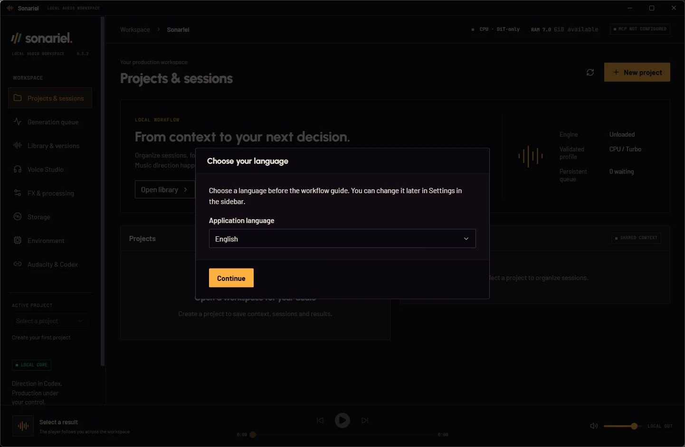
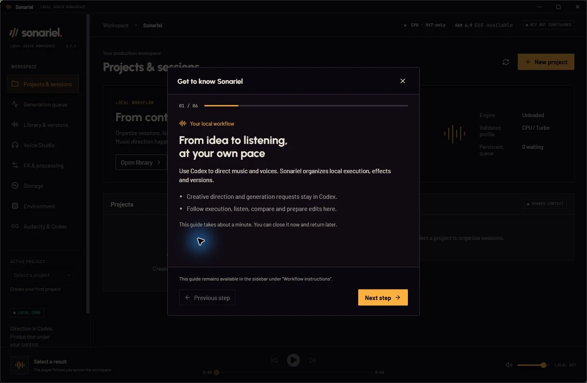
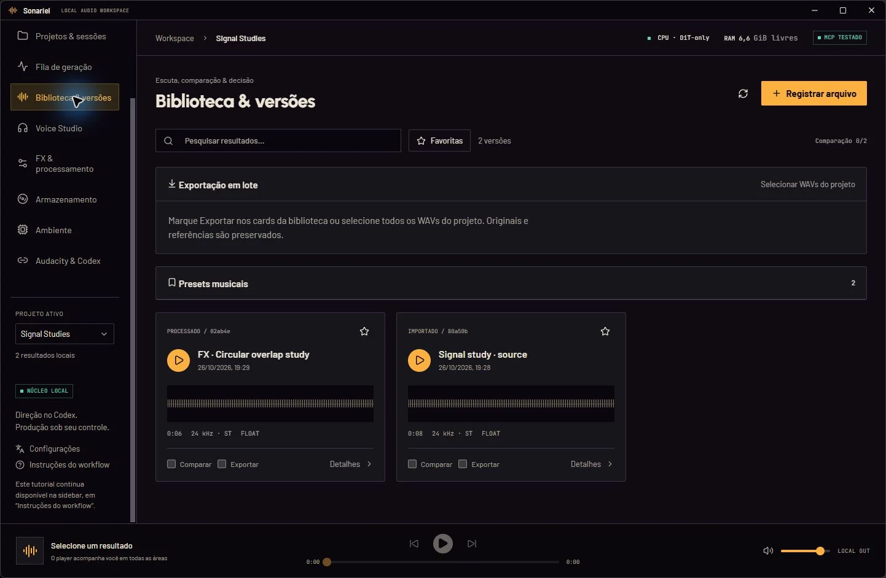
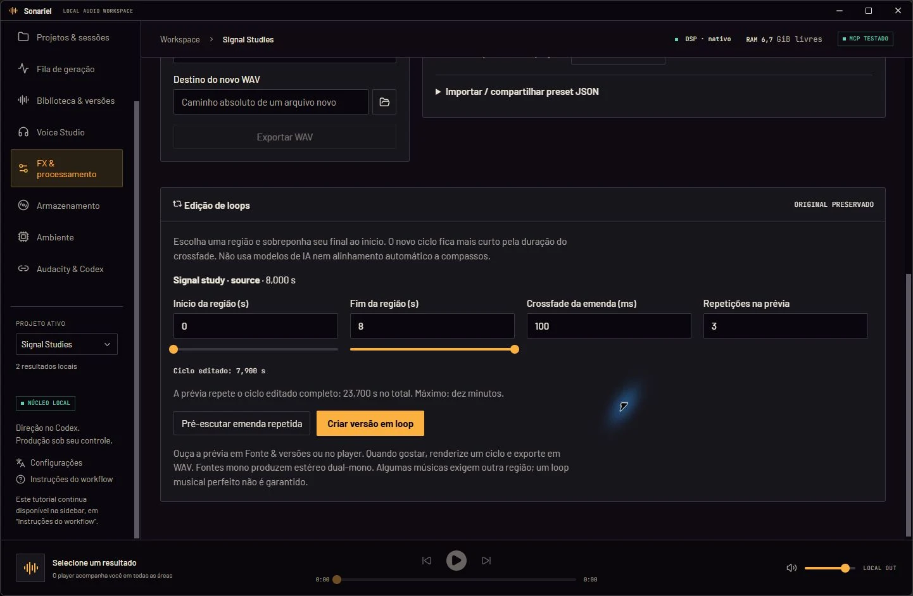

# Phase 2: internationalization and production workflow

Development baseline: main `86b6864`, distributed version **v0.3.2**. This work does not publish an installer/release, change model installations, or use production profiles. Development validation uses small synthetic WAVs and isolated application data.

## Issue audit at baseline (26 October 2026)

All nine open issues were read and compared with the existing core/UI contracts.

| Issue | Classification | Evidence and decision |
| --- | --- | --- |
| [#1 Batch export](https://github.com/SCamposs/sonariel/issues/1) | Partially implemented | `result_export` safely exports one result; library has A/B selection but no bulk export, naming policy or portable manifest. Priority for this phase. |
| [#2 Music presets](https://github.com/SCamposs/sonariel/issues/2) | Not started | Generation parameters/history and DSP presets exist; no separate reusable music-preset contract or UI. Priority for this phase. |
| [#3 Non-destructive loops](https://github.com/SCamposs/sonariel/issues/3) | Not started | Native DSP has fades/delay/layers, but no region/crossfade loop-render contract or seam preview. Priority for this phase. |
| [#4 Reference regions](https://github.com/SCamposs/sonariel/issues/4) | Partially implemented; later phase | Style/source roles, Stable source-audio compatibility and full-source duration checks exist. User-selected reference regions do not. Loop editing must not silently become reference conditioning. |
| [#5 Tags and session filters](https://github.com/SCamposs/sonariel/issues/5) | Partially implemented; later phase | Projects/sessions, search, favorites, selection and waveform comparison exist. Tags and persistent combined filters do not. |
| [#6 Strict offline](https://github.com/SCamposs/sonariel/issues/6) | Depends on experimentation | Local inference and optional update checks exist; no complete offline/cold-cache acceptance or explicit strict-offline policy. Keep open. |
| [#7 GPU profiles](https://github.com/SCamposs/sonariel/issues/7) | Depends on experimentation | Only isolated CPU recipes/adapters are supported. No driver/model/environment changes in this phase. |
| [#8 Active cancellation](https://github.com/SCamposs/sonariel/issues/8) | Depends on experimentation | Cancellation is deliberately limited to unsubmitted queued tasks. Preserve ownership/recovery safeguards. |
| [#9 Fast generation previews](https://github.com/SCamposs/sonariel/issues/9) | Depends on experimentation | Turbo uses eight steps; native DSP previews are already available but do not establish a generative draft/refinement mode. No benchmark generations here. |

## Implementation and validation record

Updated incrementally as independently verified work is completed. An implemented contract or mock test is not a live model acceptance test. Issues remain open until their actual criteria have been checked.

### Internationalization foundation

- Bundled i18next/react-i18next resources, separated by workspace, studio, storage, guide, updates, window, files, common, settings and system messages. No translation service or online language detection.
- The profile records whether it predates language preferences. Existing profiles initially keep PT-BR and retain their independent tutorial state. Fresh profiles choose a detected/suggested language before the guide; explicit language is persisted in SQLite through an additive preference-only contract.
- Settings in the sidebar changes mounted components immediately. Labels, tooltips, accessibility, notifications, dates/numbers and recognized core diagnostics are localized. Unknown external/OS diagnostics retain their verbatim technical detail with a localized recovery hint. User-authored content and stored technical identifiers are not translated.
- Foundation validation initially passed 85 Python tests and 55 TypeScript/UI tests. Final phase results and real desktop evidence are recorded below, separately from contract stubs.

### Production tools

- **Batch WAV export (#1):** independent selection in Library, native folder picker, configurable `{index}/{name}/{id}/{model}/{seed}` naming, rename/skip collision policies, per-file results, optional portable JSON and separately opted-in prompts. References require separate explicit MCP authorization and are excluded by the UI. Copies and sources are hash-verified; exclusive file creation prevents overwrites. Available model revisions are retained from render receipts without exporting their runtime/checkpoint paths. Unknown information stays absent/null. MP3 remains outside this phase.
- **Music presets (#2):** separate from DSP presets/voice profiles. Capture recognized music-result settings or save an explicit compatible configuration via MCP. Immutable revisions, independent duplicates, favorites, project listing and review are available. Prepare/reuse never generates. Confirmed repeat preserves settings; variation requires another seed. A persistent use ledger preserves preset/revision/intent lineage without changing accepted job parameters or request-key behavior. Foreign-project conditioning requires an explicit replacement. No model or LM is enabled implicitly.
- **Loops (#3):** region start/end, linear circular seam crossfade and repeated preview through native DSP. An N-frame region with L-frame overlap produces an N−L-frame cycle. The preview renders 2–4 full cycles, not a truncated ten-second excerpt; final render creates one cycle. Sources and sample rates are preserved; mono becomes explicitly documented dual-mono stereo. Region, overlap, duration, parent/hash and native receipt remain available; portable export includes the loop recipe. No automatic musical-bar alignment, AI loop conditioning or perfect-seam guarantee.
- Schema 4 backs up schema 1–3 before adding music preset/use tables. Prior settings/projects remain intact. Assets used for preset conditioning cannot be discarded. The stable app rejects the newer development database; use a separate profile.

### Validation: 26 October 2026

- Python: **104 passed** in the final full suite. Includes migration/backup, engine-specific preset validation and review/idempotence, conditioning protection/cross-project replacement, source preservation, collision/partial failure/privacy, and native loop integration.
- Frontend: **60 tests passed**, plus typecheck, bundled catalog key/placeholder parity, fallback and mounted-language/onboarding tests. Locale detection and legacy PT-BR migration are automated tests, not claims about every OS configuration.
- Rust workspace: **28 passed**. Native tests inspect cycle length, repeated samples, clipping/headroom and boundary discontinuity; no model inference is used.
- Full `scripts/build.ps1` succeeded; subsequent desktop builds validated UI refinements. A development NSIS artifact was built locally, never installed or published. Vite reports the existing >500 kB main-chunk warning; no performance benchmark is implied.
- Real packaged MCP: 55 tools discovered; a small synthetic stereo WAV was imported into an isolated project. Native loop preview and final completed in approximately **0.203 s / 0.140 s** respectively (fixture processing time, not an AI/music benchmark). The preview was verified as three exact final cycles. Original and exported SHA-256 hashes matched. Two-file batch export/manifest and collision skipping passed. Music configuration save, revision, favorite and prepare passed without inference. Only two native DSP tasks were run; no music/voice generation or model setup/loading occurred.
- Real desktop: initial language selection precedes the English tutorial; the final dialog transition waits for closure before opening the guide. Tab shows visible focus; Right/Left advance/return. The Base UI selector changes mounted UI to pt-BR with keyboard selection, localized dates/numbers, and unchanged user content. Reopening the isolated app preserves the chosen language and dismissed guide. Library/export/preset and loop panels were inspected; the main area and sidebar scroll to content below the fixed player.
- Native captures were taken at **1442 × 942**. Smaller native-window acceptance was attempted but not established by the automation; it is **not reported as passed**. Responsive rules remain in place. First-use PT-BR ordering, legacy migration and missing-key checks passed automatically; the captured first-use desktop run used English.
- Publication checks: documentation links/local targets and GitHub README rendering passed; pattern-based hygiene checked 406 reachable blobs and 203 working files without findings. This is not a complete security audit. Existing historical commit email addresses were preserved as requested; new commits use GitHub no-reply. No production assets or private helpers were staged.
- **#1 and #2 were closed as completed** after the validated code was published, with technical evidence in their issue comments. **#3 remains open for human listening acceptance of the seam.** Numerical tests and valid WAVs do not replace that explicit issue criterion; its implementation is available for evaluation. #4–#9 retain the audit classifications above.

Published commits: `5fef49f` (internationalization), `124264b` (production tools), `5ce51b7` (documentation and capture evidence). No release/tag/updater publication accompanied these commits.

### Real desktop captures

Only isolated synthetic demonstration data appears here. No production audio, private presets, personal paths, model caches or credentials are included. The images are direct app captures encoded as WebP, without generated UI or retouching. The displayed v0.3.2 version is unchanged because this is an unreleased source build.









### Test the development build

Build on Windows using the existing [development prerequisites](../CONTRIBUTING.md). Keep production profiles closed to the preview. The script below uses a separate core profile **and** separate WebView tutorial/preferences storage; it neither installs an update nor changes the distributed installer.

```powershell
npm.cmd ci
& scripts/build.ps1
$previewRoot = Join-Path $env:USERPROFILE 'SonarielPreview/phase2'
$previousWebView = $env:WEBVIEW2_USER_DATA_FOLDER
try {
    $env:WEBVIEW2_USER_DATA_FOLDER = Join-Path $previewRoot 'webview'
    & scripts/run-preview.ps1 `
        -ApplicationDirectory (Join-Path $previewRoot 'application') `
        -DataHome (Join-Path $previewRoot 'profile')
} finally {
    if ($null -eq $previousWebView) {
        Remove-Item Env:WEBVIEW2_USER_DATA_FOLDER -ErrorAction SilentlyContinue
    } else { $env:WEBVIEW2_USER_DATA_FOLDER = $previousWebView }
}
```

The process-scoped [WebView2 environment override](https://learn.microsoft.com/en-us/microsoft-edge/webview2/reference/win32/webview2-idl) isolates browser storage. Do not set it globally. The preview launcher refuses to overwrite an open preview/runtime or reuse the stable profile. Closing the UI leaves its isolated core available for MCP; no unrelated process should be terminated to refresh files. Choose another dedicated application folder if the old preview core still owns runtime files.

On first launch, choose English or Português (Brasil), then continue to the guide. Reopen **Settings / Configurações** in the sidebar to change language. Import a small WAV, select it under **FX & processing / FX & processamento**, then scroll to loop editing. Use Library for export selection and music preset review. Preview profiles have no linked engine by default: testing UI, exports and DSP does not require installing a music model.

### Next phase

Complete human loop-seam listening and small-window desktop acceptance, then investigate #4 reference-region controls and #5 combined library/session filters. Keep offline cold-cache acceptance, GPU profiles, inference cancellation and generative draft/refinement as separate evidence-led investigations. Do not promote this phase to a release until its remaining manual acceptance is resolved.
