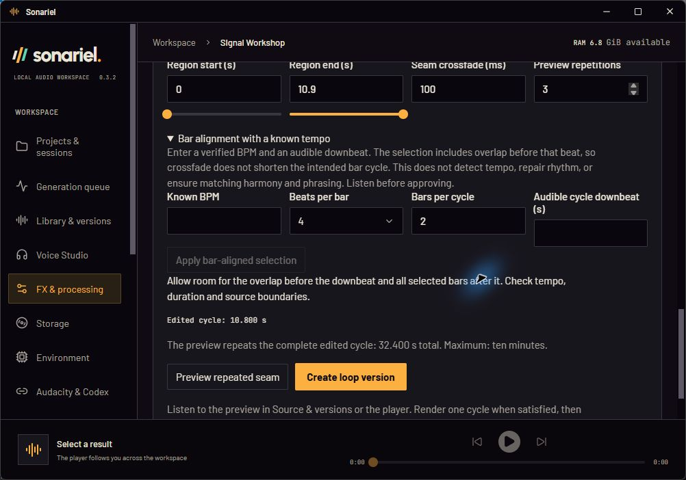
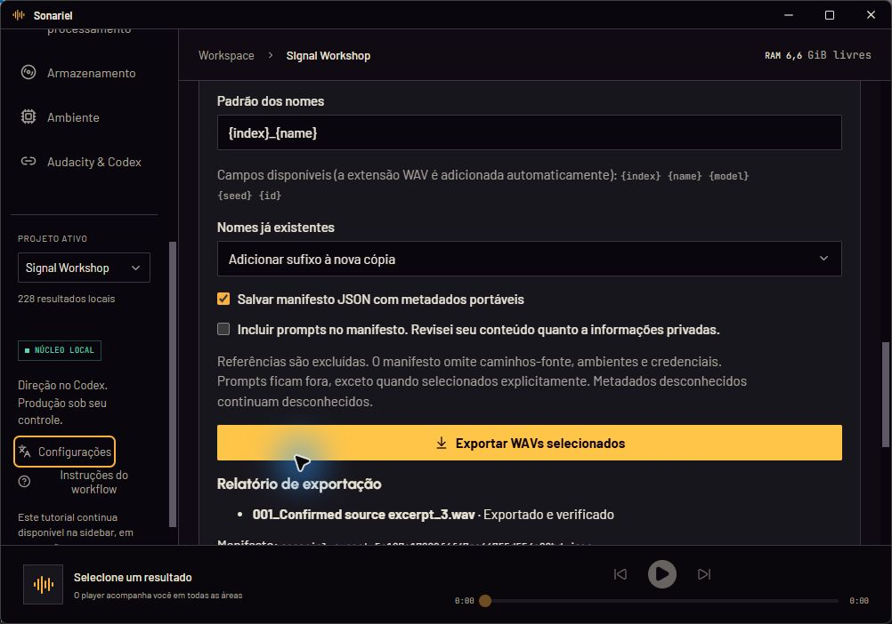
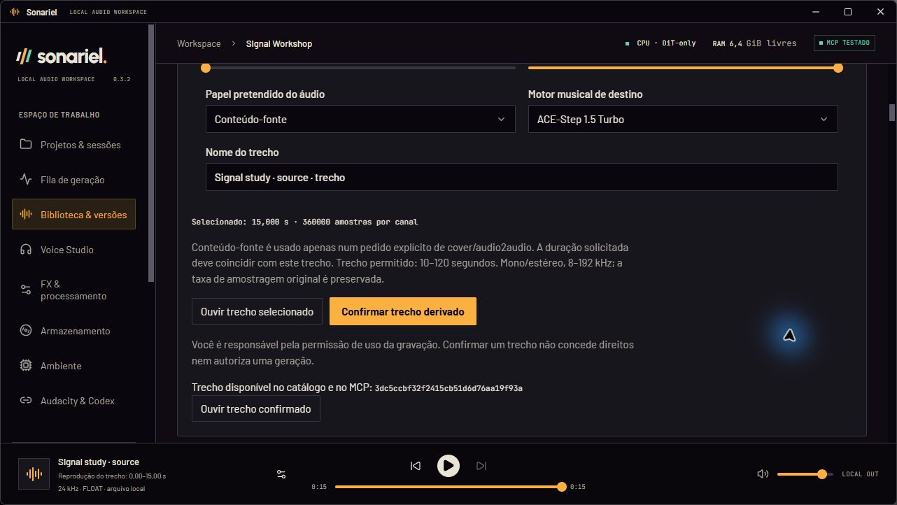
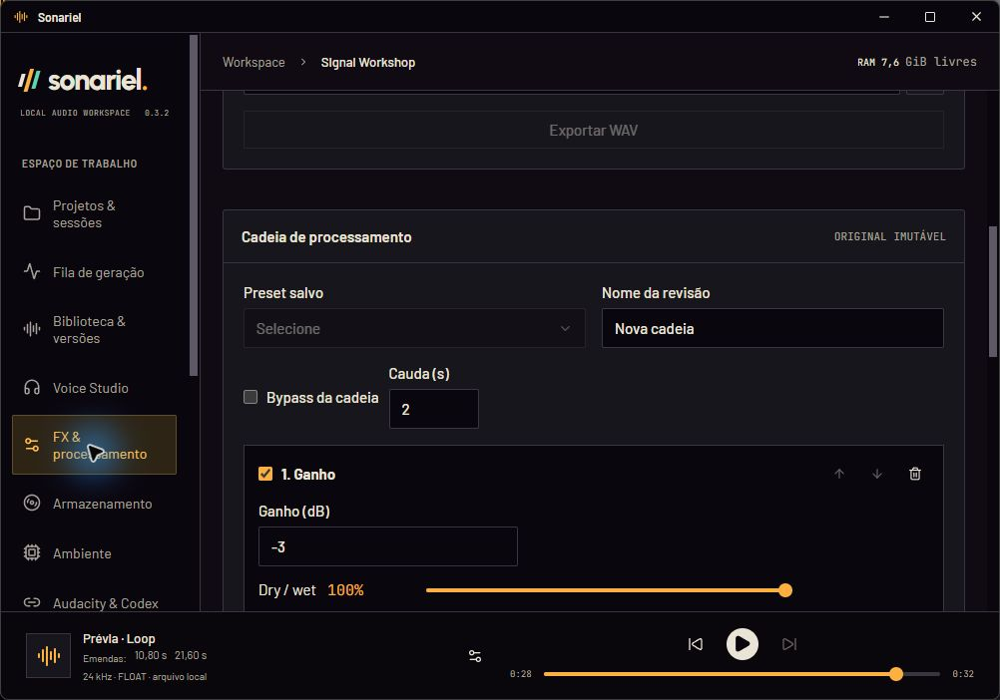
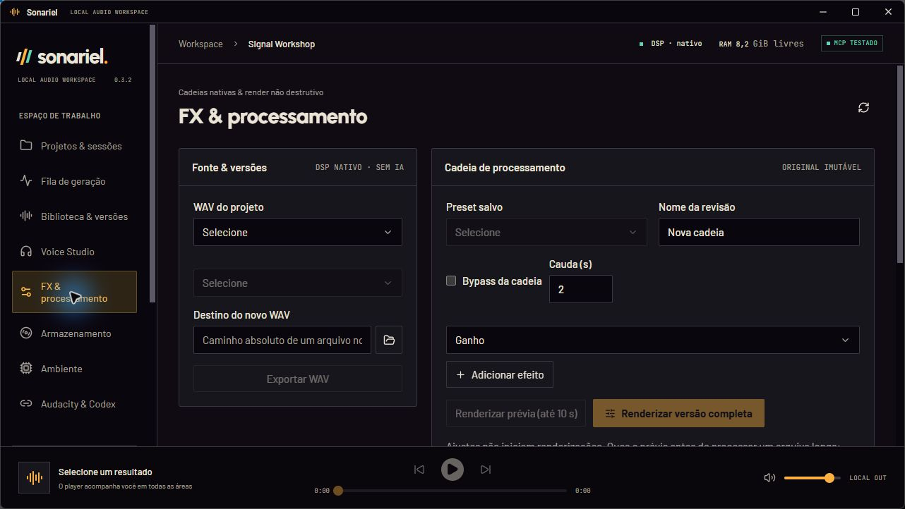
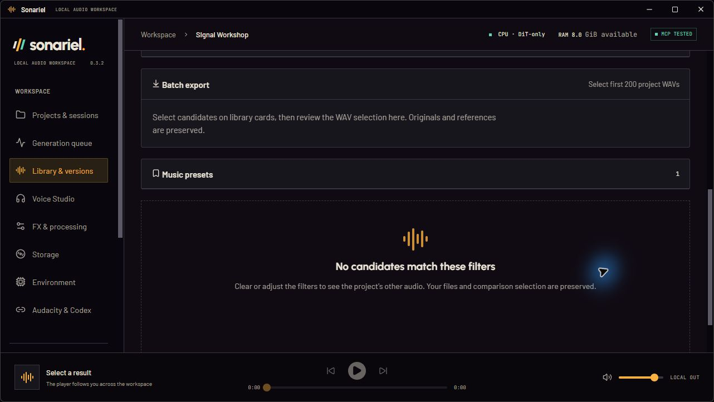
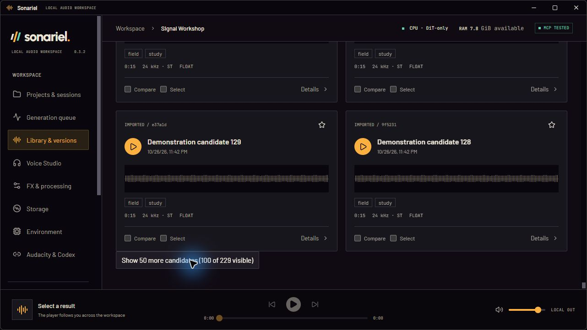

# Phase 2.5: production acceptance and library workflow

Development baseline: `cac9e0e` on main, with a clean working tree. The distributed version remains v0.3.2. No release, Store packaging, updater publication or production-profile migration is part of this phase.

## Scope and acceptance status

| Area | Current status |
| --- | --- |
| #3 Native loops | Two real private musical listening rounds **rejected by the user** for rhythmic/phrase discontinuity. Source-backed acceptance workflow and optional verified-tempo selection aid added; keep issue open. |
| Smaller desktop windows | Real targeted desktop checks passed at 1000 × 700 and 1280 × 720, in EN/PT-BR. The minimum is 1000 × 700 logical pixels; 900 × 600 is outside support. Details below identify actual interactions rather than claiming exhaustive UI certification. |
| #4 Reference regions | Sample-exact derived WAV contract and desktop editor implemented; automated, packaged MCP, native import/confirmation/player, preset review and filtered-export checks passed. |
| #5 Tags and filters | Additive metadata and project-scoped combined filters implemented; automated and packaged MCP validation passed. Real desktop bulk tagging, filtering, empty-state/pagination, A/B, export and restart checks passed. |

## Implemented contracts

`audio_region_create` takes a registered asset, stable request key, start/end seconds, name, engine ID and explicit `style` or `source` role. Boundaries are rounded to the source sample grid. The original is verified before/after processing; a new FLOAT WAV preserves channels and sample rate. Verification streams bounded blocks rather than loading a complete high-rate excerpt. No gain, resampling, crossfade, model inference or mode substitution occurs. Identical source/hash/frame/role/engine selections reuse a registered derived asset; an uncertain request must retain its original key.

The local excerpt bounds are 0.1–120 s for ACE-Step style, 10–120 s for Turbo source, and 5–120 s for Stable Audio source; mono/stereo at 8–192 kHz. These are adapter acceptance limits, not a claim of perceptual effectiveness. Stable Audio style is rejected. Derived role/engine must match the later generation or preset request; cover/audio2audio duration is checked against the derived audio. References and their reference-derived excerpts retain export/discard protection. Parents remain protected by lineage. Rights remain the user's responsibility.

The editor previews the selected interval through the existing player. Loop-preview join positions are navigation buttons in that player, with 750 ms lead-in; they do not insert audio markers. Final loop WAVs remain one cycle.

`asset_tags_update` adds/removes tags atomically on up to 200 explicit assets in one project. NFKC, whitespace folding and casefold deduplicate names, with 1–48 visible characters and at most 32 tags per audio. Tags live outside immutable audio/generation metadata. `project_tags_list` lists active tags only in that project. No defaults from production are shipped.

Organizational tags stay in the local catalog and are not automatically included in portable export manifests. Their free-form text may contain private project information. Filtering/export selection does not authorize publishing those annotations.

`results_list` retains its default behavior and adds combined project-specific query/favorite/session/kind/tag filters. Tags use AND. `library_filters_save` persists those filters per project; invalid cross-project sessions/tags fail closed. Removed tags are pruned from saved active filters. Import/reference registration now optionally accepts a session from the same project. The desktop serializes preference writes, resets project-specific selection and retains the existing A/B, WAV export, waveform and lineage features. Cards load in groups of 50; bulk operations clearly cap selection at 200 rather than silently sending oversized requests.

Schema 5 adds `asset_tags`, `library_filters` and `region_requests`. Existing schema 1–4 databases receive a consistent SQLite backup before migration. Settings, presets, jobs, asset rows and files remain intact; newer schemas are rejected by older cores. All validation uses separate profiles.

## Validation: 27 October 2026

- Python full suite: **120 passed**, including 15 region/library tests and beat-grid/native duration validation.
- Frontend: **71 passed**, plus typecheck. Includes filters, serialization, region confirmation, bar compensation, player join positions, module scroll isolation, retention of the FX source/unsaved chain across module navigation and distinct sibling workspace identities without leaking the draft into another project.
- Rust native workspace: **28 passed**. Tauri's test target compiled and ran successfully with **zero unit tests**; this is not a native UI test claim.
- Eighteen known new domain diagnostics have EN/pt-BR presentation mappings. New UI catalogs have matching keys and interpolation parameters; known technical IDs and user content remain untranslated.
- Native DSP algorithms and engine RAM gates are unchanged. Musical listening files, source identities, hashes, timestamps and receipts stay private and must not be committed.
- Real packaged MCP: **59 tools** discovered. Confirmed sample-exact source/style assets, duplicate-request recovery, identical-region reuse, source-role preset review without inference, 225 demonstration candidates, bulk tags on 200, combined filters, native loop and portable export passed in the first isolated functional build. No music or voice generation was submitted.
- Smaller native window: **1000 × 700 logical / 1002 × 702 captured**. English first-use dialog and EN/PT-BR guides fit with accessible actions. PT-BR tutorial arrow navigation and Escape/focus return passed. A long source dropdown responded to End/Up/Enter. An actual region was confirmed from the desktop and its resulting ID appeared. Main/sidebar scrolling reached controls below the fixed player. Module navigation inherited the previous module's scroll, an observed defect corrected with a separate scroll position per module/project and verified in the native desktop.
- Updated core was rebuilt successfully. Its real packaged MCP run again discovered 59 tools and passed the functional contracts, including a three-cycle 12 s beat-grid preview. Portable export was inspected to confirm organizational tags are omitted. The separate test profile contains synthetic demonstration audio only; no inference was requested.
- At **1280 × 720 logical / 1282 × 722 captured**, the EN first-use language dialog and tutorial fit. EN → PT-BR applied immediately; Escape closed Settings and visibly returned focus to its trigger. Library → Voice Studio opened at the top after scrolling the library; returning restored the library's own position, verifying the scroll fix. FX and its loop panel, setup cards and music presets were reachable by scrolling above the fixed player. The PT-BR desktop applied `Interface study` to 200 explicitly selected demonstration assets; `interface study` appeared among project filters, and a read-only SQLite check confirmed exactly 200 associations. These are isolated generic fixture annotations, not production defaults.
- The 1280 × 720 PT-BR region editor also confirmed a new 15 s source excerpt. Playback used the existing footer player, displayed the selected interval and stopped at its end. Confirmation exposed the derived asset ID below the controls; scrolling reached it above the player.
- A rebuilt **1000 × 700** desktop passed EN first-use/tutorial controls, Right-arrow navigation, Settings/locale switching, visible focus in the details drawer and Escape return to the Details trigger. Queue, voice, FX, setup, storage and bridge views were opened in EN; the lower voice form, processing chain and full loop/known-tempo controls were reachable by scrolling. A real three-cycle native-DSP preview was submitted from the UI and completed in the shared queue. A source-region type filter reduced the library to one candidate; comparison selection and export selection remained separate. The native Windows folder chooser returned the private destination, and the UI exported that candidate with a portable manifest and a collision suffix. A separate read-only check verified source/export/manifest SHA-256 agreement, original preservation and omission of tags/prompts. Switching to PT-BR translated the existing export report without restarting.
- The desktop review exposed a second context defect: returning from the queue reset the selected FX source and unsaved chain. A project-keyed workspace now mounts FX only on its first visit and retains that local draft while other modules are shown. It writes no draft to disk, starts no processing and resets when the project changes. Native 1000 × 700 navigation retained the source, unsaved gain stage and scroll position. A subsequent 1280 × 720 Voice → FX retest caught colliding React sibling keys in the first retention implementation. The navigation regression was reproduced automatically, fixed with distinct identities and verified again in the packaged desktop; Voice content is removed when FX opens.
- Real 1000 × 700 PT-BR A/B selection displayed two waveforms and both playback controls switched the shared player to the corresponding candidate. A three-cycle preview exposed joins at 10.80/21.60 s; the second join button sought to the expected lead-in and playback crossed 21 s. Closing/reopening the isolated app retained PT-BR, the active project, catalog and saved source-region filter. These are interaction checks using synthetic audio, not musical listening approval.
- Projects, queue, library, voice, FX, storage, setup and bridge views were opened in both languages across the two supported test sizes. Lower forms/actions, library region confirmation, filtered export, the preset panel, dialogs, long dropdowns, sidebar scrolling and fixed-player use were checked as described above. Custom title-bar maximize/restore, minimize (confirmed minimized by the native helper), restore and close/reopen were exercised. No destructive storage action, model setup or production Audacity edit was used for this validation.
- The initial native attempt was stopped by physical Escape; subsequent input used newly authorized intervals. Screenshots and private receipts distinguish completed interactions from limitations. This is targeted desktop acceptance, not certification of every assistive technology, display scale or external engine/DAW configuration.
- The final authorized native checkpoint passed in the corrected 1280 × 720 build: the Windows file chooser selected an existing synthetic WAV, the desktop assigned its destination session and registered one candidate (228 → 229 results). A read-only comparison with the earlier registered original confirmed its hash was unchanged. A nonmatching search displayed the specific no-match state and recovery guidance; Clear filters restored all 229 results. The existing music preset was reviewed from the desktop, which explicitly confirmed no task was queued; the private store still contained only the same three completed native-DSP jobs. Show more changed the visible library limit from 50 to 100 of 229, and the next controls remained reachable above the fixed player. The native helper session was reinitialized before this final authorized round; no app data was reset.
- Publication hygiene checked 457 reachable Git blobs and 225 working files with no configured secret/path/media pattern findings after the implementation commits and final captures. This is a bounded pattern check, not a complete security audit. Local documentation validation checked 31 Markdown files, 163 links and 18 image references without errors. Existing historical author emails were retained as authorized; new commits use GitHub no-reply.

## Human loop listening protocol

Use a private isolated project. For each music source compare the unchanged original, a selected region with no crossfade, and the same region with the proposed seam overlap. Render one final cycle and a separate preview of at least three consecutive cycles. Preserve exact region/crossfade parameters, original/derived hashes, cycle duration, join times, lineage and export results in the private manifest.

Listen at the same output level, using the player join buttons to replay transitions. Assess clicks, missing attacks, duplicated rhythm, harmonic jumps, sustained-texture dips/surges and an obviously shortened phrase. Numerical sample continuity and finite/headroom checks are separate technical results. Rhythmic/sustained characterization of existing music is a human listening observation until confirmed. No agent, tokenizer, waveform or automated metric approves the perceptual result.

Acceptance must come from the user. Both rounds were heard and rejected for rhythm breaks and lack of musical continuity. Numerical spectral/onset similarity in the second round did not satisfy that criterion. The [revised, source-backed protocol](LOOP_ACCEPTANCE.md) separates musical phrase/timing checks from boundary integrity. A circular crossfade alone does not align beats, harmony or phrase boundaries. The optional bar-selection aid compensates overlap using user-supplied verified timing, without estimating BPM or enabling warping. Keep #3 open while independent work continues.

## Native desktop evidence

Direct isolated app captures, without generated UI or retouching. Only generic synthetic demonstration content is shown; musical listening material and personal filesystem paths remain private. The displayed v0.3.2 is the unchanged development version, not a new release.

## Limits and issue disposition

The native existing-file import, preset review and empty-state/pagination checkpoint passed after a newly authorized round. Issues #4/#5 meet their implemented acceptance criteria; their final disposition follows publication of the validated commits. #3 remains open with two rejected listening rounds. #6–#9 remain independent investigations. No new release/tag/updater feed or installed-app update is part of this phase.

Implementation commits: `324fecc` (core contracts/schema/tests) and `1787af6` (bilingual desktop/interaction tests). Publication and final issue disposition are verified separately from local commit creation.

No heavy AI generation, cold-cache setup, new GPU profile or production Audacity handoff was run. New region roles/engine compatibility were verified through contracts, preset review and rejection tests without claiming a live model-generation benchmark. The native frontend build retains its existing bundle-size warning (main JavaScript approximately 736 kB / 235 kB gzip); this phase did not introduce dependency splitting or a new UI framework.

## Use a separate development preview

Follow the [isolated preview instructions](PHASE2.md#test-the-development-build), choosing a new dedicated application folder, profile and WebView folder for Phase 2.5. Never point a source preview at the stable profile: schema 5 cannot be opened by the distributed v0.3.2 core. Models are not required for library, region, export or native-DSP checks.

In Library, register a small authorized WAV and optionally choose its session. Select candidates to add/remove organizational tags, combine filters and review the export selection independently of A/B. Expand **Audio regions & reference roles / Trechos de áudio & papéis de referência**, choose the source, engine and role, listen, then confirm its derived asset. For processing, choose that WAV in FX; inspect a preview before rendering a final version. Scroll to Loop editing and evaluate three cycles before any human approval. Optional verified-tempo selection does not repair a composition that cannot repeat musically.

Use Settings to switch EN/PT-BR immediately. Reopen the workflow guide from the sidebar. Closing the preview window does not install, update or modify the stable app; its isolated core can remain available to MCP. Do not terminate unrelated processes when refreshing the preview.
