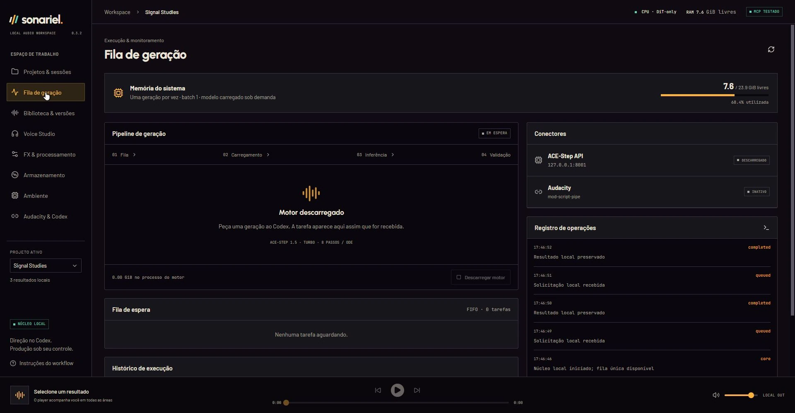

# Real desktop screenshots

[Overview](../README.md) · [Documentation](README.md)

These are captures of the actual **v0.3.2 Windows desktop**, made on 26 October 2026. The UI is in Brazilian Portuguese. They preserve the shipped typography, panels, colors and controls; no mockups or generated UI images are used.

## Demonstration data and operations

The **Signal Studies** project was created in a fresh, separate `SONARIEL_HOME` using the packaged core and MCP server. No production database, private prompts, recordings, game data or voice references were opened or copied into it. The original source is a newly synthesized 24-second, 48 kHz stereo tone study imported as a WAV. It is **not AI-generated music**.

Real MCP operations created the project/sessions, registered the WAV, saved two project presets, submitted two native DSP jobs, waited for completion, selected one demonstration version and exported a verified WAV. No music/voice model was downloaded or loaded. The source hash was checked again after processing; the source was preserved.

| Version | Processing | Result |
| --- | --- | --- |
| Signal study · source | Imported synthetic WAV | 24 s original |
| FX · Soft room | −3 dB gain, 70 Hz high-pass, reverb (22% wet, 6 m room, 1.2 s decay, 12 ms predelay), 0.5/1.5 s fades | New 26 s WAV, including 2 s tail |
| FX · Wide echo | −6 dB gain, delay (25% wet, 320 ms, 0.3 feedback), 0.5/1.5 s fades | New 26 s WAV, including 2 s tail |

The favorite/selection is only a showcase choice, not an artistic approval or model-quality claim. The audio, profile database and local capture receipts remain outside Git. The **MCP TESTADO** indicator comes from an actual handshake with the isolated demonstration client; it is not evidence of a new integration test with every agent product.

## Views

- [Projects and sessions](images/projects.webp): real project context, two sessions and a selected version.
- [Library and comparison](images/comparison.webp): the imported source compared with the Soft room render, with actual waveform/level measurements.
- [Native FX](images/fx.webp): source relationships, two processed versions and the saved Soft room effect chain. The remaining chain controls are below the viewport.

The queue capture shows its **idle state after DSP work**, not a music generation in progress. Its ACE-Step baseline label does not mean that engine ran. The completed entries in the operation log are the two native DSP tasks above. RAM readings describe the capture moment, not a benchmark or minimum requirement.

Images are 1920 × 1000 WebP files. The only processing is cropping 32 pixels from the top capture/title-bar edge and compressing the actual screenshot. There is no content retouching, substituted status, added waveform or staged progress. Images were reviewed for personal paths, credentials, private names and unrelated applications before publication. No audio or raw profile is distributed with this gallery.

## Recording proposal and presentation follow-ups

A public recording of the full agent → music request → queue → listening → export flow is **not available in this phase**. Screenshots document the real lightweight import/DSP workflow without starting unnecessary models. A future short, silent recording can use a fresh demo profile, a generic original prompt and one explicitly authorized short generation. Show the actual submission/result; label any loading-time cuts and review every frame for private paths. Do not animate a simulated task as evidence of inference.

Two existing UI details are left for a later functional change: DSP versions currently receive the generic **GERAÇÃO** badge in the library, and the idle queue uses the baseline ACE-Step label even after native DSP jobs. Captions above identify the actual operations. Neither was changed for this documentation work. The desktop UI itself has not been translated to English; supporting historical guides also retain their documented languages.
