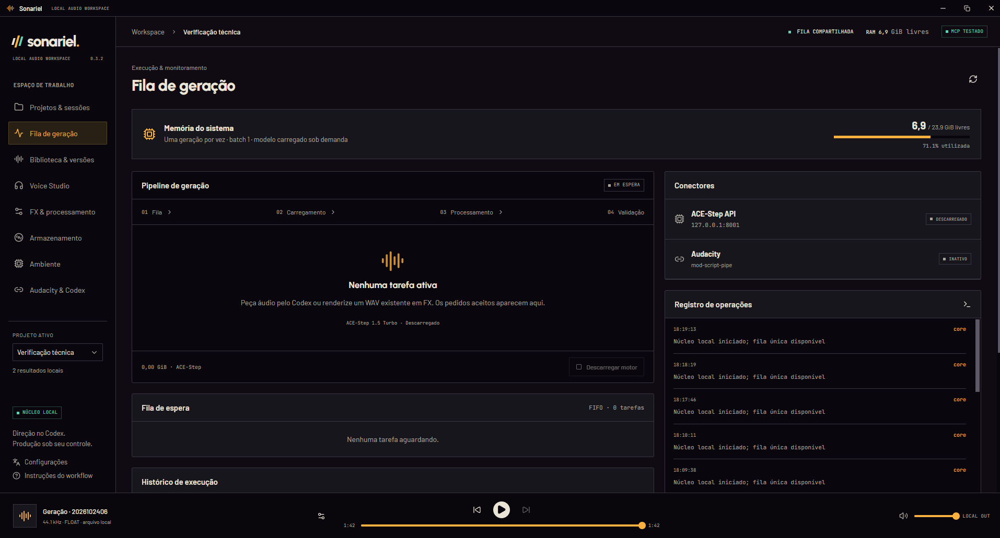

# Real desktop screenshots

[Overview](../README.md) · [Documentation](README.md)

These are captures of the actual **v0.3.2 Windows desktop**, supplied by the author on 26 October 2026 and also used in the [Sonariel portfolio case](https://italo-portfolio-rust.vercel.app/es/projects/sonariel). The UI is in Brazilian Portuguese; the current v0.4.0 release also supports English. They preserve the actual typography, panels, colors and controls; no mockups or generated UI images are used.

## Current gallery

The author-supplied PNGs replace the earlier WebP screenshots that contained the remote-control cursor overlay. They were copied unchanged from the portfolio's public image assets; no new captures, retouching or substituted interface content were needed. The selected workspace is **Verificação técnica**. Its presence does not establish that the entire application profile is an isolated demonstration profile.

- [Projects and sessions](images/projects.png): project list, selected technical-verification workspace and its session context.
- [Library and versions](images/library.png): two registered audio versions, waveforms, playback, comparison-selection and batch-export controls. The side-by-side comparison is not open.
- [Native FX](images/fx.png): effects editor before source selection, with chain, preview and revision controls. The historical loop section is visible; **packaged v0.4.0 disables loop creation**.

The queue is idle, with no active job. Its RAM readings describe that capture moment, not a benchmark or minimum requirement. The player can retain an earlier audio selection independently of the current module. Neither the player nor an engine label proves that a generation ran during a capture. The **MCP TESTADO** badge is a status shown by the application, not a test of every agent client.

All four PNGs were reviewed for the unwanted cursor overlay, personal filesystem paths, credentials and unrelated applications. They contain the already-public workspace labels and audio titles supplied by the author. No audio, database or raw profile is included in the gallery. File dimensions are preserved from the portfolio originals.

## Historical lightweight showcase evidence

The original screenshots documented a separate **Signal Studies** session. The recorded operations below remain historical evidence; they do **not** describe the replacement images above.

The **Signal Studies** project was created in a fresh, separate `SONARIEL_HOME` using the packaged core and MCP server. No production database, private prompts, recordings, game data or voice references were opened or copied into it. The original source is a newly synthesized 24-second, 48 kHz stereo tone study imported as a WAV. It is **not AI-generated music**.

Real MCP operations created the project/sessions, registered the WAV, saved two project presets, submitted two native DSP jobs, waited for completion, selected one demonstration version and exported a verified WAV. No music/voice model was downloaded or loaded. The source hash was checked again after processing; the source was preserved.

| Version | Processing | Result |
| --- | --- | --- |
| Signal study · source | Imported synthetic WAV | 24 s original |
| FX · Soft room | −3 dB gain, 70 Hz high-pass, reverb (22% wet, 6 m room, 1.2 s decay, 12 ms predelay), 0.5/1.5 s fades | New 26 s WAV, including 2 s tail |
| FX · Wide echo | −6 dB gain, delay (25% wet, 320 ms, 0.3 feedback), 0.5/1.5 s fades | New 26 s WAV, including 2 s tail |

The historical favorite/selection was only a showcase choice, not an artistic approval or model-quality claim. The audio, profile database and local capture receipts remain outside Git. Its MCP indicator came from an actual handshake with an isolated demonstration client, not a test of every agent product.

## Recording proposal and presentation follow-ups

A public recording of the full agent → music request → queue → listening → export flow is **not supplied by this gallery**. A future short, silent recording can use a fresh demo profile, a generic original prompt and one explicitly authorized short generation. Show the actual submission/result; label loading-time cuts and review frames for private paths. Do not animate a simulated task as evidence of inference. This screenshot replacement changes documentation and image files only.
